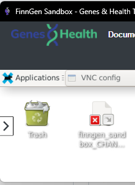
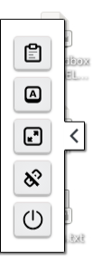
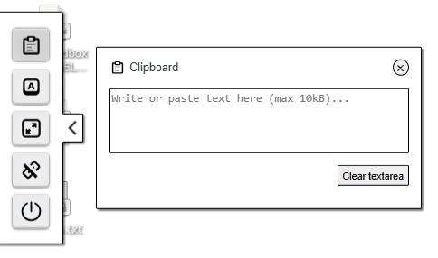
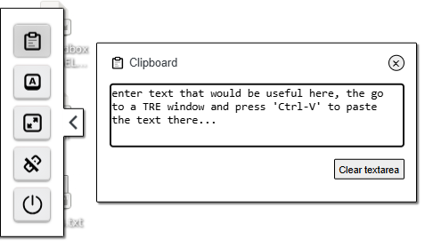
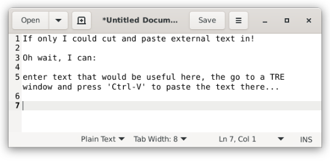

# Getting data into the TRE

Sometimes it is necessary to get data, text or code into the TRE. As the TRE is shut off from the internet this presents a challenge. 

There are two ways to get data, text or code into the Genes&Health TRE. For large amounts of data, you can upload data to your Sandbox's `red` directory via the Sandbox's specific `green_uploads` bucket. For small amounts of text (e.g. code snippet generated externally or short codelist), you can use the TRE's clipboard tool.

These methods are described below.

## Uploading user data into the TRE {#getting-user-data-into-the-tre}

You can upload data to your Sandbox specific `green_uploads` bucket, which you can find using the table below:

| Sandbox | Link to green-uploads bucket |
| :---- | :---- |
| Sandbox 1 \- QMUL \+WSI Core Team Desktop | [https://console.cloud.google.com/storage/browser/qmul-production-sandbox-1\_greenuploads](https://console.cloud.google.com/storage/browser/qmul-production-sandbox-1_greenuploads) |
| Sandbox 2 \- External Academic Desktop | [https://console.cloud.google.com/storage/browser/qmul-production-sandbox-2\_greenuploads](https://console.cloud.google.com/storage/browser/qmul-production-sandbox-2_greenuploads) |
| Sandbox 3 \- GSK Desktop | [https://console.cloud.google.com/storage/browser/qmul-production-sandbox-3\_greenuploads](https://console.cloud.google.com/storage/browser/qmul-production-sandbox-3_greenuploads) |
| Sandbox 4 \- BMS Desktop | [https://console.cloud.google.com/storage/browser/qmul-production-sandbox-4\_greenuploads](https://console.cloud.google.com/storage/browser/qmul-production-sandbox-4_greenuploads) |
| Sandbox 5 \- MSD Desktop | [https://console.cloud.google.com/storage/browser/qmul-production-sandbox-5\_greenuploads](https://console.cloud.google.com/storage/browser/qmul-production-sandbox-5_greenuploads) |
| Sandbox 6 \- Takeda Desktop | [https://console.cloud.google.com/storage/browser/qmul-production-sandbox-6\_greenuploads](https://console.cloud.google.com/storage/browser/qmul-production-sandbox-6_greenuploads) |
| Sandbox 7 \- Pfizer Desktop | [https://console.cloud.google.com/storage/browser/qmul-production-sandbox-7\_greenuploads](https://console.cloud.google.com/storage/browser/qmul-production-sandbox-7_greenuploads) |
| Sandbox 8 \- S00050\_FFAIR-PRS Desktop | [https://console.cloud.google.com/storage/browser/qmul-production-sandbox-8\_greenuploads](https://console.cloud.google.com/storage/browser/qmul-production-sandbox-8_greenuploads) |
| Sandbox 9 \- Maze Therapeutics Desktop | [https://console.cloud.google.com/storage/browser/qmul-production-sandbox-9\_greenuploads](https://console.cloud.google.com/storage/browser/qmul-production-sandbox-9_greenuploads) |
| Sandbox 10 \- Novo Nordisk Desktop | [https://console.cloud.google.com/storage/browser/qmul-production-sandbox-10\_greenuploads](https://console.cloud.google.com/storage/browser/qmul-production-sandbox-10_greenuploads) |
| Sandbox  11 \- University of Exter | [https://console.cloud.google.com/storage/browser/qmul-production-sandbox-11\_greenuploads](https://console.cloud.google.com/storage/browser/qmul-production-sandbox-11_greenuploads) |
| Sandbox 13 \- AstraZeneca | [https://console.cloud.google.com/storage/browser/qmul-production-sandbox-13\_greenuploads](https://console.cloud.google.com/storage/browser/qmul-production-sandbox-13_greenuploads) |
| Sandbox 14 \- External Academic, Consortium access | [https://console.cloud.google.com/storage/browser/qmul-production-sandbox-14\_greenuploads](https://console.cloud.google.com/storage/browser/qmul-production-sandbox-14_greenuploads) |
| Sandbox 16 \- Sandbox 16 | [https://console.cloud.google.com/storage/browser/qmul-production-sandbox-16\_greenuploads](https://console.cloud.google.com/storage/browser/qmul-production-sandbox-16_greenuploads) |
| Sandbox 17 \- Academic, NHS Digital access | [https://console.cloud.google.com/storage/browser/qmul-production-sandbox-17\_greenuploads](https://console.cloud.google.com/storage/browser/qmul-production-sandbox-17_greenuploads) |

Once uploaded, please email [hgi@sanger.ac.uk](mailto:hgi@sanger.ac.uk) with the names of the files/directories you'd like to be transferred and which Sandbox you like them to be transferred to.

!!! danger "Patient identifying data"
    Please do not transfer any patient identifying data to the G&H TRE, for example data containing patient names, NHS numbers, dates of birth, etc. 

!!! tip
    Please be aware at present, all users in your sandbox can see all data that is being stored in the green library. For this reason, it is important that you do not upload any data that you do not want other users to see.

## Copying text in {#copying-text-in}

You can paste small amounts of text (up to 10 kB) into the TRE from your own computer using the Clipboard tool. This works in one direction only: you can't copy text out of the TRE.

This is useful for things that are tedious to retype, such as a long function or a configuration snippet.

1. Select the chevron on the left-hand side of the TRE window:

   

   This opens the TRE tools:

   

2. Select **Clipboard**:

   

3. Paste the text from your own computer into the text box with <kbd>Ctrl</kbd>-<kbd>V</kbd> (<kbd>Cmd</kbd>-<kbd>V</kbd> on a Mac):

   

4. Click into a terminal, text editor or other application inside the TRE, then paste with <kbd>Ctrl</kbd>-<kbd>V</kbd>:

   
