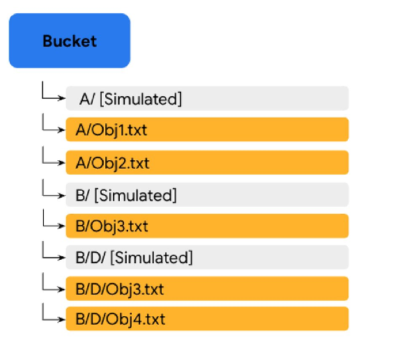

# Understanding Google Cloud Storage (GCS) buckets

To undertand how Genes & Health data are stored and how to use the data resources, we need to understand **Google Cloud Storage (GCS) buckets**.  GCS buckets are used for all data storage in the TRE with the exception of user data in the `home` directory.

Genes & Health TRE data are stored in Google Cloud Storage (GCS) buckets (on a server located in London, UK). Buckets are the basic data container for GCS and everything stored in GCS must be contained in a bucket.

Each of the G&H TRE top level storage domains are separate GCS buckets, for example, `library-red`, `red` and `exomes-library-red`. Files in a G&H TRE bucket are just that. The bucket contains a collection of files (or "objects" in GCS-speak).

## GCS buckets and directories

The concept of a physical directory does not rightly exist in GCS. Rather, directories are “simulated” by GCS from the files name. This can be illustrated as follows:  

In the image above, the filenames are `A/Obj1.txt`, `A/Obj2.txt`, `B/Obj3.txt`, `B/D/Obj3.txt` and `B/D/Obj4.txt` and the files simply exists a files in the bucket with those filenames. 

Bucket folders `A/`, `B/` its sub-folder `D/` are simulated. This means that if you were to delete `A/Obj1.txt` and `A/Obj2.txt`, the simulated folder `A/` would disappear (there would no longer be any files justifying its existence). 

However, if you were to delete file `B/Obj3.txt`, both simulated folder `B/` its sub-folder `D/` would remains as they would be accounted for by filenames `B/D/Obj3.txt` and `B/D/Obj4.txt`.

If you were to delete all the .txt files in the bucket, all of the directories would disappear but the bucket would remain in existance.

## GCS and the Genes&Health TRE

The Genes&Health TRE has three main GCS buckets: `red`, `library-red` and `nhsdigital-sublicence-red`.  In addition, users have access to a `home` directory.  The `home` directory is associated with the Google Cloud virtual machines and is not a GCS bucket _per se_.  These and related ancillary Genes&Health buckets are described in the [Understanding TRE forlders and buckets](./understanding-tre-folders-and-buckets.md) section of this documentation.
