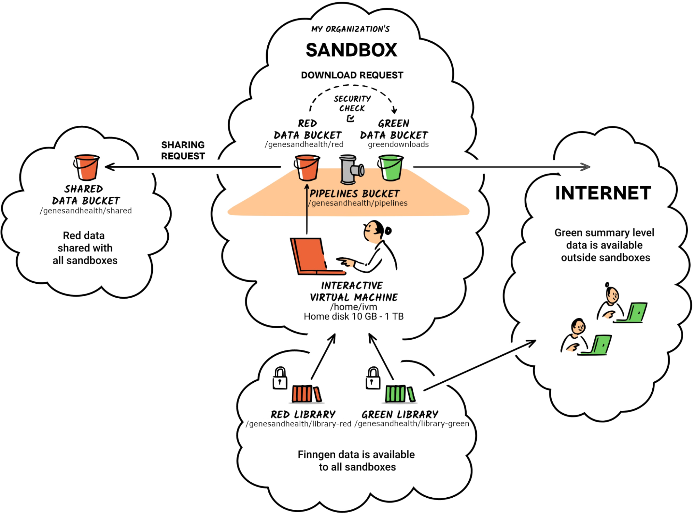

# Understanding TRE folders and buckets

To understand how Genes&Health data are stored and how to use these data resources, as well as where user data are stored, you need to understand **Google Cloud Storage (GCS) buckets**.  GCS buckets are used for all data storage in the TRE with the exception of user data in their `home` directory. The Google Cloud Storage (GCS) buckets are explained in the [Understanding Google Cloud Storage buckets](./understanding-google-cloud-storage-buckets.md) section of this documentation.

## What's in the bucket? Where is my `home` directory?

The _fundamental_ storage resources in the TRE are:

* your `home` directory
* the `library-red` and `red` buckets containing respectively the G&H -omics data and **your** sandbox's data
* the `nhsdigital-sublicence-red` folder (for a restricted set of users whose hosting organisation has signed a sublicence with NHS England)

These exist alongside a number of other data resources as illustrated below.  Key data resources are then individually described.

{ width = 80% }

!!! note "`home` directory"
    The `home` directory is associated with the Gene & Health virtual machines rather than GCS --so it is (and behaves as) a standard unix directory.  Files and directories in `home` are created, manipulated and deleted as in Unix/Linux.
    !!! info "`home` directory location"
        **Your** `home` directory is a sub-directory of `/home/`: **`/home/ivm/`** --you have read/write access to **`/home/ivm/`** but read-only access to `/home/`. The `home` directory is **persistent**. When you close a virtual machine, the `home` directory will not be deleted and will present the same way next time you spin a new virtual machine --regardless of the configuration of the new VM.
        

        Although the `home` directory is persistent, its use is recommended only for development purposes; we advise ensuring critical code and data are regularly copied to the `red` folder.
        
## Identifying G&H GCS buckets

G&H buckets can be identified into two way within the TRE:

1. As a **linux path on the virtual machine**, for example `/genesandhealth/red/`.
2. As a **GCS bucket** identified by a **Uniform Resource Locator (URL)**, for example `gs://qmul-production-sandbox-1-red/` (which identifies the `red` bucket on sanddox-1).

Depending on the file operation you may need to use one or the other method of identifying the bucket.

!!! note
    A bucket's URL may depend on the sandbox you use.

## Red vs Green

The `red` directory or directories suffixed with `-red` (e.g. `library-red`) contain patient-level data. **Their content should never be shared externally.** Folders with `green` within the folder name contain data which may be visible from or exportable to TRE-external users.  As such, `green` folder should **never contain patient level data**.  Your `home` directory should be thought of as a `red` directory.      

## The TRE's `(-)red` buckets (including the non-GCS `home` directory) 

### Your `home` directory

!!! info "Identifying `home`"
    * **Specificity:** sandbox and user specific
    * **VM directory:** `/home/ivm`
    * **URL:** Not applicable

Available at `/home/ivm` in your sandbox, this is your personal folder. This folder can be used to store any files you wish to keep in your working directories. `/home/ivm` is a semi-fast (HDD) storage and as such is faster than other parts of the sandbox. It might be worth transfering some data here from slower storage on the VM (e.g. the `/red/` bucket) especially if you scripts are processing large datasets.

This folder should not be treated as a permanent/long-term storage so anything you want to keep should be moved to the `red` folder. However, snapshots of the disk/folder are taken on daily basis and are retained for a period of 7-days. In-case you accidently delete some useful data from the `/home/ivm` folder, you can reach out to the TRE Admins to check if it is possible to recover the disk to a previous snapshot date within last 7 days.

This works as a standard Unix/Linux directory and is **not** a google GCS bucket (hence the absence of a URL for your `home` directory).  Your `home` directory can only be accessed by yourself or system administrators.

### The `library-red` bucket \[read-only for users\]

!!! info "Identifying `library-red`"
    * **Specificity:** common to all sandboxes
    * **VM directory:** `/genesandhealth/library-red/`
    * **URL:** `gs://qmul-production-library-red/`

This is a **read-only** folder that is common to all TRE users. `library-red` stores curated and raw data necessary for your analyses; it includes several subfolders, each designated for specific data types and purposes.  For technical reasons, the data subfolders are actually in `/genesandhealth/library-red/genesandhealth/`.  Folder names are (relatively) self-explanatory and all of them should contain a `README` type file explaining their content.  If you find a folder without a `README` file, please contact the Genes and Health team for more information on its intended use.

### The `red` bucket

!!! info "Identifying `red`"
    * **Specificity:** sandbox specific
    * **VM directory:** `/genesandhealth/red/`
    * **URL:** `gs://qmul-production-sandbox-XX-red/` (replace `XX` with your sandbox number, e.g. '1' (not '01') or '17') 

The `red` bucket is a read-write bucket for TRE users to store scripts and data safely (with versioning back-up) and to permit the sharing of these between project collaborators. It is the only GCS bucket **directly** accessible to non-admin TRE users.  You are advised to create your own subfolder in `red`; user folders are typically created as FirstnameLastname (so `/genesandhealth/red/JoeBloggs/`) although some iconoclasts have broken this convention.

!!! danger "With great power..."
    The `red` bucket is shared between all sandbox users **—even if you have created your own sub-directory**.  This means that you can:
    
    * See all other sandbox users' files (and all other sandbox users can see your files)
    * Move/rename/delete **any** sandbox users' files 
    

    
    **Exercise caution when moving or deleting files in the `red` bucket.**

### The `consortiumpriorityperiod-library-red` bucket

!!! info "Identifying `consortiumpriorityperiod-library-red`"
    * **Specificity:** restricted sandboxes
    * **VM directory:** `/genesandhealth/consortiumpriorityperiod-library-red/`
    * **URL:** `gs://qmul-production-library-consortiumpriorityperiod-red` 

This bucket is only available to the core Genes & Health team, and to companies in the Genes & Health Industry Consortium. It contains data restricted during priority access periods. Specifically, read access is only for sandboxes 1, 3, 4, 5, 6, 7, 9, 10, 13.

### The `nhsdigital-sublicence-red` bucket

!!! info "Identifying `nhsdigital-sublicence-red`"
    * **Specificity:** restricted sandboxes
    * **VM directory:** `/genesandhealth/nhsdigital-sublicence-red/`
    * **URL:** `gs://qmul-production-library-nhsdigital-sublicence-red` 

This bucket is only available to hosting organisations (e.g. QMUL) which have signed their own sublicencing agreement with NHS England.  This bucket contains raw data from "NHS Digital", for example: HES data, IAPT data, National Diabetes Audit data.  Although access to the bucket is restricted, data processed from this bucket and no longer directly attributable to NHS England are made available to TRE users (e.g. Binary traits produced by the `BI_PY` pipeline include trait information _derived_ from "NHS Digital").

## The TRE's `green` buckets

!!! warning
    We removed sandbox specific `green` buckets in Nov 2026. These are no longer available. If you encounter a `/genesandhealth/green` directory in you sandbox, **please do not use it** and assume it and its content may be deleted at any time.

### The `green_upload` bucket

Users can upload to sandbox-specific green_uploads, then email hgi@sanger.ac.uk to review and move to their red bucket for use.  The process is explained in the [How to get your data in](../getting-data-in-and-out-of-the-TRE/how-to-get-your-data-in.md) section of this documentation.

!!! info "Identifying `green_upload`"
    * **Specificity:** sandbox specific
    * **VM directory:** Not applicable
    * **URL:** `gs://qmul-production-sandbox-XX_greenuploads` (replace `XX` with your sandbox number, e.g. '1' (not '01') or '17') 
    
Although the URL is specified for this GCS bucket, you are unlikely to use this but rather will use the web-based Google Cloud console to upload your file in preparation for transfer to the Genes&Health TRE: `https://console.cloud.google.com/storage/browser/qmul-production-sandbox-\[your_sandbox_number\]_greenuploads`.
    
### The `green_download` bucket

Users can download data from `greendownloads` (or `library-green`) using linux command line `gcloud storage`.  The process is explained in the [Requesting data out of the TRE](../getting-data-in-and-out-of-the-TRE/requesting-data-out-of-the-TRE.md) section of this documentation.

!!! info "Identifying `green_download`"
    * **Specificity:** sandbox specific
    * **VM directory:** Not applicable
    * **URL:** `gs://qmul-production-sandbox-XX_greendownloads` (replace `XX` with your sandbox number, e.g. '1' (not '01') or '17') 

Although the URL is specified for this GCS bucket, you are unlikely to use this but rather will probably use the web-based Google Cloud console to download your file in preparation for from the Genes&Health TRE: `https://console.cloud.google.com/storage/browser/qmul-production-sandbox-\[your_sandbox_number\]_greendownloads`.

### The `consortiumpriorityperiod-library-green` bucket

!!! info "Identifying `consortiumpriorityperiod-library-green`"
    * **Specificity:** restricted sandboxes
    * **VM directory:** `/genesandhealth/consortiumpriorityperiod-library-green/`
    * **URL:** `gs://qmul-sandbox-production-library-consortiumpriorityperiod-green`
    
Access as for `consortiumpriorityperiod-library-red` but with external download enabled. Used for results. **Not for individual level data**.

### Other folders

<!--
I don't think this directory exists anymore (if it ever did)
#### `shared`

You can 'publish' a file to `/genesandhealth/shared` by right clicking on it, and selected 'Share with all users'

`/genesandhealth/shared` is available to all other users within the TRE.
-->

### Public datasets bucket

We also maintain a bucket for public datasets. This is not visible from within the TRE. Much of the data is mirrored in `/genesandhealth/library-green/` within the TRE.

!!! info "Identifying `genesandhealth_publicdatasets`"
    * **Specificity:** public
    * **VM directory:** Not applicable
    * **URL:** `https://console.cloud.google.com/storage/browser/genesandhealth_publicdatasets`

Access to the public datasets is described in the [Public data](what-genetic-and-health-data-are-where/genetic-data/public-data.md) section of this documentation.

#### `pipelines`

This is the output of the high performance compute WDL Pipelines, that the ivm/pipeline writes to. Users of the sandbox have read only access.

Specific to each sandbox.

This is slower storage of large capacity (\>8 PiB @ Feb 2022\)

## Backups

Data in selected folders is protected from accidental deletion or alteration by the Google Object Versioning service. Specifically, for data in these folders \-

### Shared folders

`/genesandhealth/library-red` , 1 version, 30 days

`/genesandhealth/consortiumpriorityperiod-library-red`, 1 version, 30 days

`/genesandhealth/nhsdigital-sublicence-red`, 1 version, 30 days

### Sandbox-specific folders

`/genesandhealth/red`, 2 versions, 30 days

`/genesandhealth/pipeline`, 1 version, 7 days

We will keep either a) the prior version of the data prior to a change (or deletion) by a user for 30 days , or b) two prior versions of the data prior to a change (or deletion) by a user for 30 days.

This allows the prior version to be restored, in the event of accidental erasure or deletion.

To say this another way: imagine you accidentally alter or delete a file in the `/genesandhealth/library-red` folder. Then the version of the file prior to its removal can be restored, for up to 30 days after the change. In the sandbox-specific `/genesandhealth/red` folder, two prior versions of the file will be kept, each for 30 days after the change leading to its creation.

Restoring a prior version of an accidentally removed or modified file requires utilities only available to administrators: if you need this, contact us by writing to <hgi@sanger.ac.uk>, including the word "Urgent" in the subject header.

